# Professor Platform

A web-based educational management platform developed with **Django**. The application provides a centralized environment for managing courses, students, online learning activities, academic content, research projects, and appointments.

## Project Overview

Professor Platform is designed to support academic activities through dedicated interfaces for students and administrators.

## Main Features

- **Dashboard:** Overview of academic activities.
- **Course Management:** Course catalog and course details.
- **E-Learning:** Online training, learning progress, and quizzes.
- **Student Area:** Student dashboard and learning activities.
- **Certificates:** Certificate of successful completion.
- **Research:** Scientific publications and research projects.
- **Administration:** User management and appointment management.
- **Contact:** Contact form and communication interface.

## Screenshots

### 1. Public Interface and Courses

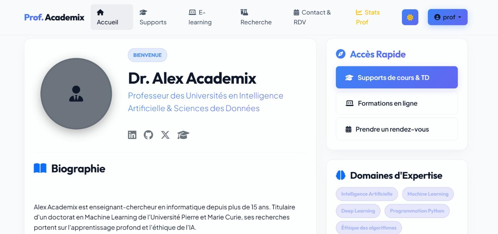

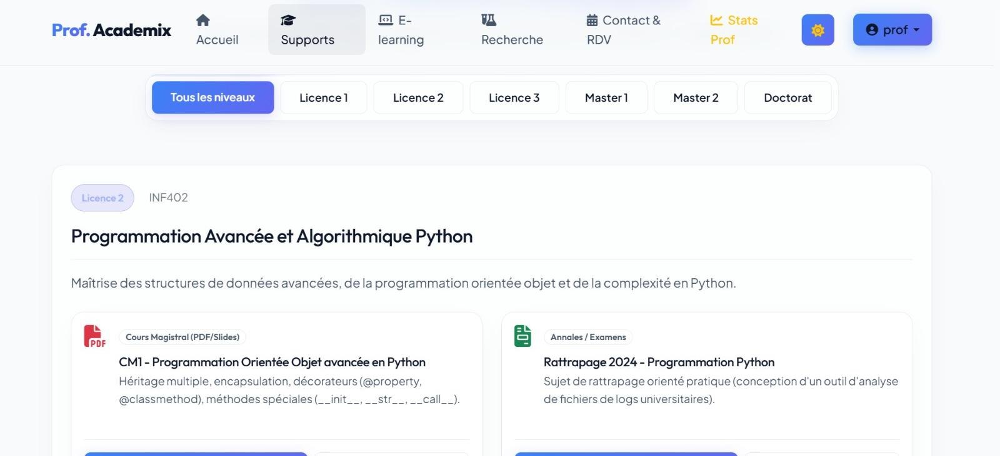

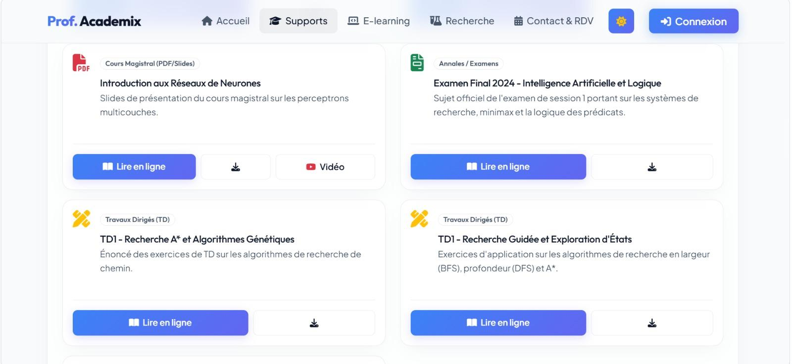

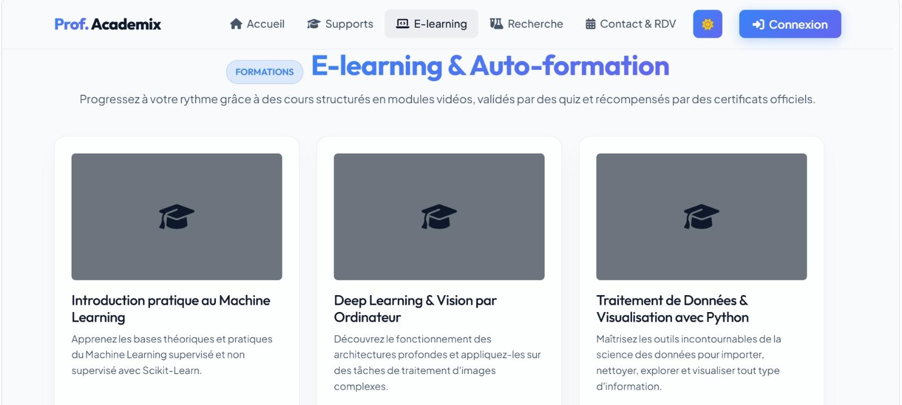

### 2. Student Learning Area

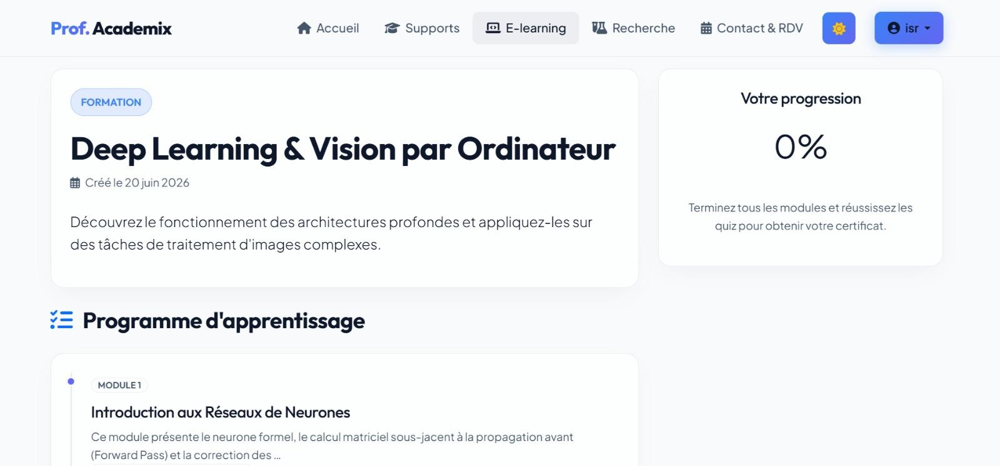

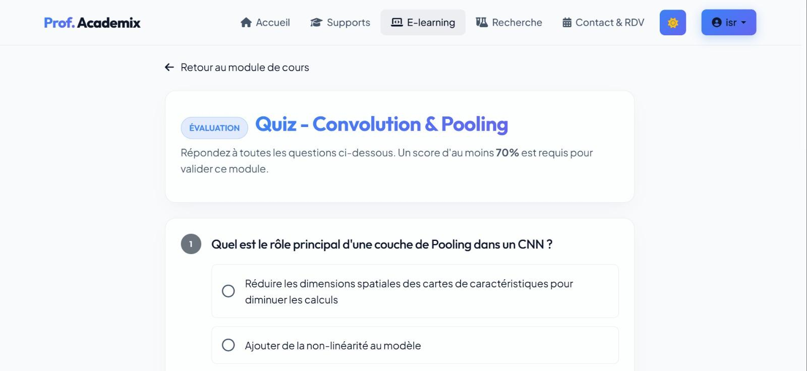

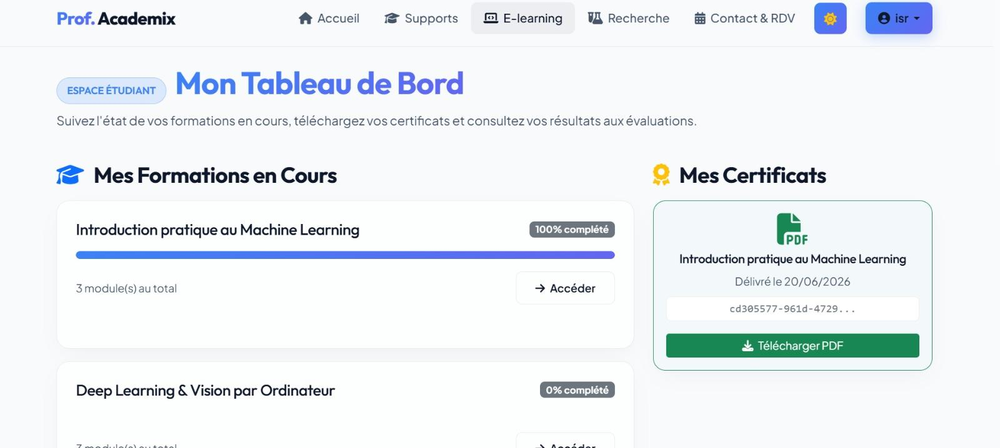

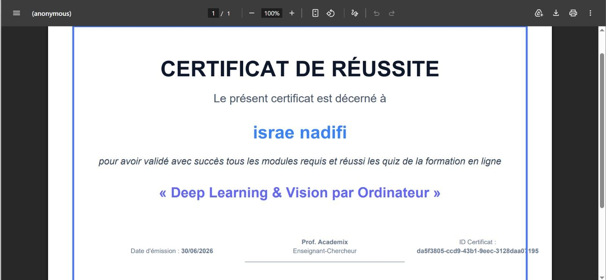

### 3. Research and Academic Content

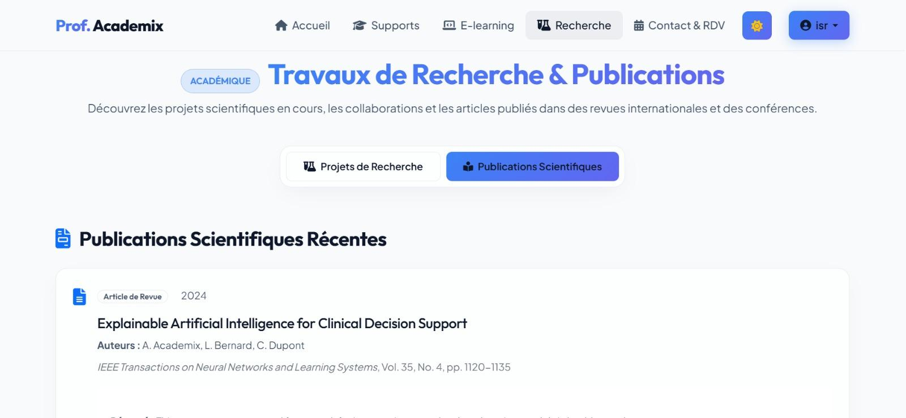

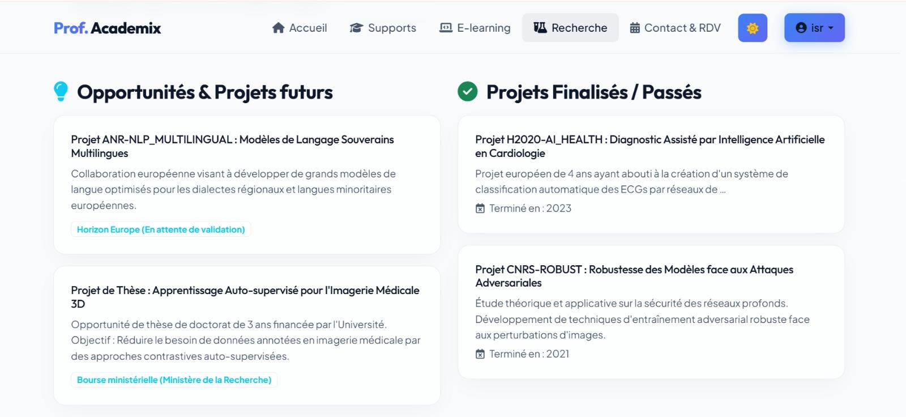

### 4. Administration Area

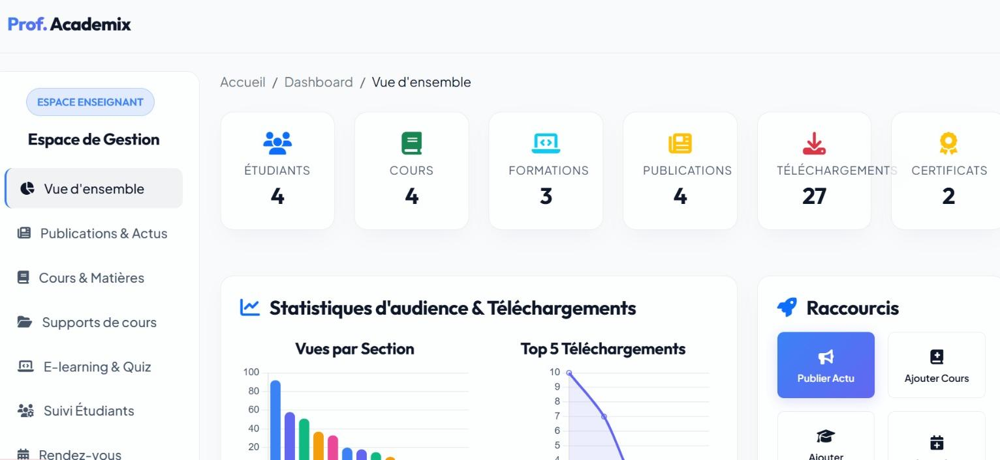

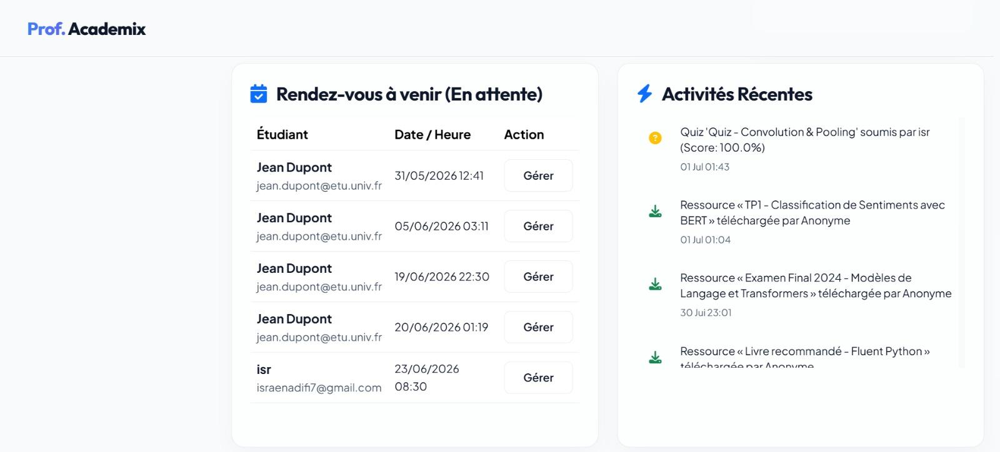

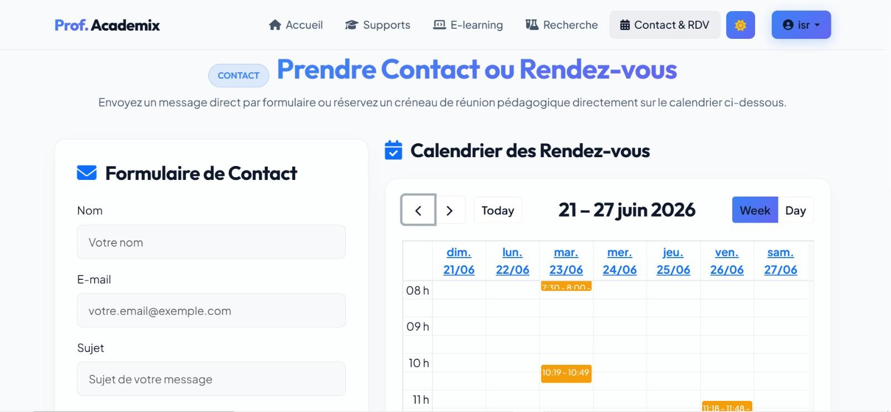

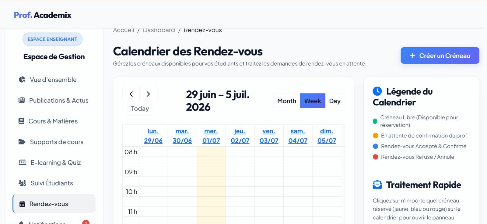

## Technologies Used

- Python
- Django 6.0.5
- SQLite
- HTML5
- CSS3
- JavaScript
- Matplotlib
- python-dotenv

## Project Structure

```text
professor-platform/
├── analytics/
├── core/
├── courses/
├── elearning/
├── platform_prof/
├── research/
├── scheduler/
├── static/
│   └── css/
├── templates/
├── screenshots/
├── manage.py
├── requirements.txt
└── .gitignore
```

## Installation

### 1. Clone the repository

```bash
git clone https://github.com/AfafAK/professor-platform.git
cd professor-platform
```

### 2. Create a virtual environment

```bash
python -m venv .venv
```

Activate it on Windows:

```bash
.venv\Scripts\activate
```

### 3. Install dependencies

```bash
pip install -r requirements.txt
```

### 4. Configure environment variables

Create a `.env` file in the project root directory:

```env
SECRET_KEY=replace-with-your-secret-key
DEBUG=True
ALLOWED_HOSTS=localhost,127.0.0.1
SECURE_SSL_REDIRECT=False
```

Never publish your actual secret key or other credentials.

### 5. Apply database migrations

```bash
python manage.py migrate
```

### 6. Run the development server

```bash
python manage.py runserver
```

Open your browser at:

http://127.0.0.1:8000/

## Security

- Environment-based configuration using python-dotenv.
- Secret key stored outside the source code.
- Debug mode configurable through environment variables.
- Sensitive files excluded using `.gitignore`.
- Django security middleware and password validators.

## Project Status

The project is under development and subject to continued testing, improvements, and documentation.

## Author

**Afaf Ait Khouya**

GitHub: [AfafAK](https://github.com/AfafAK)

Repository: [Professor Platform](https://github.com/AfafAK/professor-platform)
